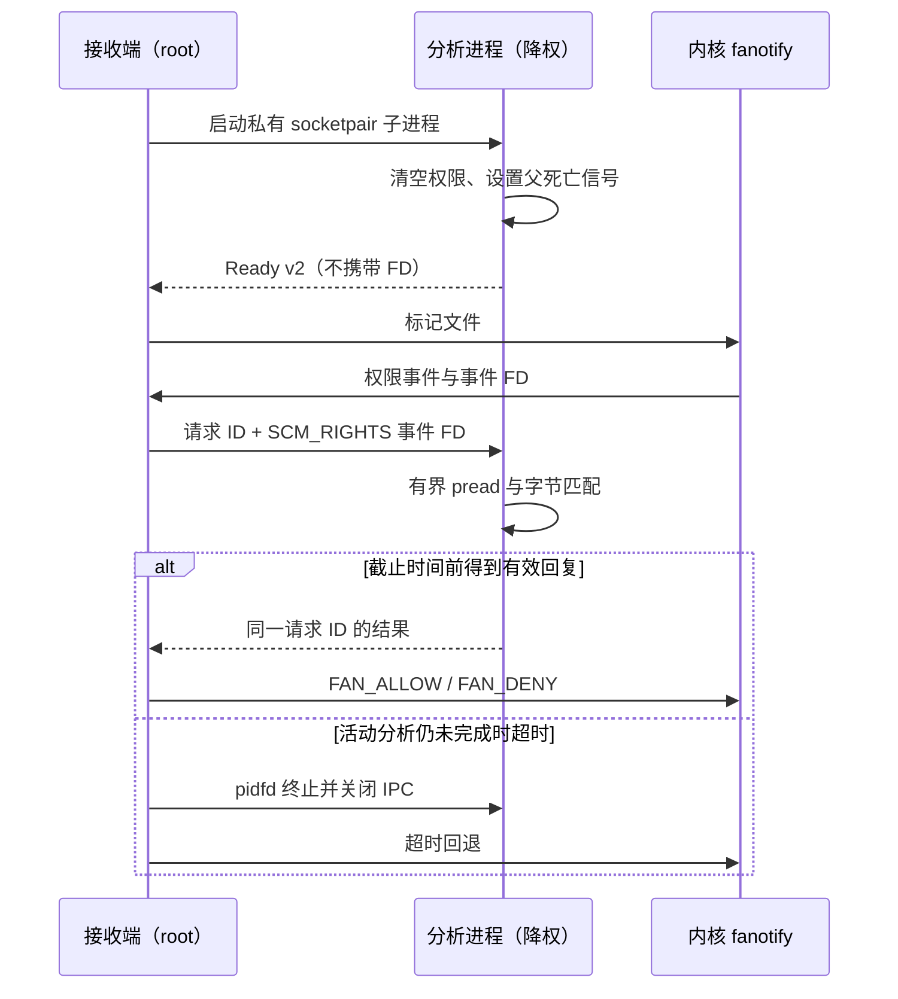

# 独立内容分析组件

`secmon-fanotify` 可以启动独立的 `secmon-analyzer`，把实际事件 FD 通过私有 Unix socketpair 传给它。首版规则是有界的字节串匹配：文件包含给定标记则拒绝，否则允许；不能完整扫描、读取失败或扫描期间发现普通元数据变化时返回分析错误。这是可复现实验规则，不是恶意内容检测引擎。

## 运行

准备一个只用于实验的普通文件，把分析程序路径写成绝对路径：

```bash
sudo ./build/secmon-fanotify --file /absolute/path/test-file --run-for 20 \
  --analyzer /absolute/path/build/secmon-analyzer --deny-marker SECMON_BLOCK \
  --request-timeout-ms 250 --max-pending 64 --analyzer-error-decision deny
```

不能同时使用 `--decision` 或 `--decision-delay-ms`。不启用 analyzer 时，原有静态/模拟延迟模式保持可用。`--event open|access|exec` 仍然选择不同的权限入口，范围见 [fanotify 实验](FANOTIFY_LAB.md)。

| 参数 | 含义 |
| --- | --- |
| `--analyzer ABSOLUTE_PATH` | 接收端启动的可信程序；由管理员选择，不自动验证签名或文件来源 |
| `--deny-marker TEXT` | 1..256 字节的非空字面标记，不是正则表达式；不能表示 argv 中的 NUL |
| `--scan-limit-bytes N` | 1..1048576，默认 65536（必要时额外读 1 字节检测增长）；超限返回错误，不把未扫描部分视为干净 |
| `--analyzer-error-decision allow|deny` | 分析错误或后端不可用时的回退，默认 deny |

## 模块与数据流

| 文件 | 职责 |
| --- | --- |
| `src/analysis/protocol.h` | 有版本、长度和非零请求 ID 的固定宽度本地协议 |
| `src/analysis/transport.h/.cpp` | 非阻塞 SOCK_SEQPACKET 与 SCM_RIGHTS；所有接收到的 FD 均由 RAII 关闭 |
| `src/analysis/client.h/.cpp` | 启动/监督一个子进程、单个在途分析、pidfd 终止与有界回收 |
| `src/analysis/scanner.h/.cpp` | 只读普通文件的有界 pread、跨块标记匹配与基本变化检查 |
| `src/analysis/worker_main.cpp` | 工作进程参数、降权、父进程退出处理和扫描循环 |
| `src/fanotify/decisions.h/.cpp` | 接收后的截止时间、队列容量、请求 ID 与回退 |
| `src/fanotify/gate.cpp` | 同时轮询权限事件和分析回复，最终写入 FAN_ALLOW/FAN_DENY |

接收端保留原事件 FD，分析端仅取得该文件打开对象的另一个引用，不接收路径，也没有 fanotify/BPF 管理 FD。启动动作只保留必要的标准 FD 和 IPC FD；使用 pread 不改变共享打开对象的文件偏移。

事件 FD 带有内核的 FMODE_NONOTIFY 标记，SCM_RIGHTS 保留同一个打开对象。因此读取该 FD 不会再次产生相同 fanotify 事件，避免扫描本身递归等待。相关语义见 [fanotify(7)](https://man7.org/linux/man-pages/man7/fanotify.7.html) 与 [unix(7)](https://man7.org/linux/man-pages/man7/unix.7.html)。必须继续使用原事件 FD，不能随意替换成按路径重新打开。

root 启动时，分析程序清空补充组并降到 UID/GID 65534；随后显式清空 permitted/effective/inheritable/ambient capabilities，设置 no_new_privs 并关闭 dumpability。父进程死亡信号在降权后设置并核对预期父 PID，避免降权清除信号设置和启动竞争。普通用户直接运行内部协议测试时保留其原 UID，也显式清空 capabilities。当前没有 seccomp、网络隔离或完整沙箱，不能把独立进程和降权当作完整隔离。

协议当前版本为 2：工作进程完成凭证与父死亡信号设置后，先发送不携带 FD 的 Ready 消息（ID=0）。接收端最多等待 1 秒，确认版本、长度与 Ready 字段后才继续固定文件和启用 fanotify 标记。初始化失败、无 Ready 或畸形 Ready 会在策略生效前失败退出；这也消除了测试在分析进程尚未初始化时就暂停它的竞态。

启动使用本机 glibc 的 `posix_spawn_file_actions_addclosefrom_np`；当前只支持项目声明的开发环境，不提供旧 libc 兼容层。

请求头与回复头均包含 magic、版本、长度和 ID；请求固定 16 字节，回复固定 24 字节。这是同机、同构建布局的本地协议，不是跨平台网络格式。

| 报文 | ID / 结果 | FD 数量 |
| --- | --- | --- |
| Ready | ID=0，result=ready，bytes=0 | 0 |
| 扫描请求 | 非零且在当前实例中递增的 ID | 恰好 1 |
| 分析回复 | 与当前活动请求相同的 ID，allow/deny/error | 0 |

SCM_RIGHTS 传输层的辅助缓冲预算为 8 个 FD，但应用协议仍只允许上述数量。超额或截断会拒绝报文并关闭已收到的 FD；这是 IPC 辅助数据截断，不是 fanotify 内核权限队列溢出。接收前预分配所有权存储，确保 `recvmsg` 安装 FD 后不再为接管它们进行内存分配；独立的分配故障测试验证失败时原消息尚未被消费。

## 握手、FD 与裁决顺序



接收端负责内核回复与期限，分析进程只产生结果。普通文件分析错误不等于整个后端故障；协议或进程故障则使后端离线。显式选择 error=allow 会允许无法分析的请求，默认 deny 则拒绝它们，两者都不能改变组关闭后的内核放行语义。

## 故障与资源预算

- 用户态队列最多 `max_pending` 个原始事件 FD；工作进程一次最多接收一个副本，不把整条等待队列复制进 socket。
- 单请求截止时间仍从接收端收到内核事件开始计算，包括等待前面请求完成的时间。截止时间优先于迟到回复。
- 仍未完成的活动分析超时后，通过 pidfd 终止工作进程并关闭连接，释放其事件 FD 副本；剩余请求和后续请求执行后端错误回退，不无限重试或自动重新启动。
- 协议错误、连接关闭、发送失败也使后端离线。普通单文件扫描错误只回退该请求，工作进程可以继续服务。
- 正常停止时先拒绝用户态待裁决请求，再停止工作进程并释放 fanotify 组。组关闭仍会放行内核尚未投递的请求；进程异常退出也没有持久拒绝保证。
- 子进程回收不阻塞活动裁决循环；组关闭之后的析构回收最多等待约 200 ms。不可中断的文件系统任务可能晚于这一预算退出，不能保证任意 I/O 都能立即取消。

统计中的 `analyzed` 是成功得到 allow/deny 分析结论的回复数，`analysis_denied` 是其中的拒绝子集；`analyzer_error` 是错误回退的请求数，`analyzer_failures` 是后端转为离线的次数。它们和原有超时/容量计数一样，不应重复加到 allowed/denied 总量中。

## 验证与边界

```bash
ctest --test-dir build --output-on-failure
sudo python3 tests/fanotify_analysis.py --build-dir build
sudo python3 tests/run_privileged.py --build-dir build --analysis-soak-duration 30
```

已验证真实内容允许/拒绝、同 inode 内容变化、root 所有文件经传递 FD 由降权进程扫描、open/access 下无递归、大文件错误回退、工作进程崩溃、SIGSTOP 卡住后的超时及 pidfd 终止、接收端崩溃后释放待裁决请求。确定性测试覆盖跨读取块标记、只读/普通文件要求、长度上限、FD 偏移、协议截断与 FD 关闭。

文件内容不是不可变快照，元数据比较只捕捉普通并发变化；允许之后的写入、已有映射和内容再次变化仍按各权限入口的边界处理。本轮没有实现签名、哈希白名单、真实恶意行为识别、策略热更新、可信应用授权或完整保险箱。后续需在这个接口上分别推进分析规则和可信身份，而不是把示例标记当作攻击判断。


协议专项测试分别覆盖接收和回复两侧：`analysis_protocol.py` 在无特权条件下向真正的扫描进程发送错误请求；`fanotify_analysis_faults.py` 使用仅在 BUILD_TESTING 时构建的故障工作进程，验证错误 ID/版本/长度/裁决值、重复与迟到回复、九个 FD 超过八个辅助数据 FD 预算后的清理。请求者提前退出的竞态已实测不会中断后续请求。这些故障程序不参与正式程序的正常运行。


新增启动协议专项：缺少 Ready、错误 Ready 与携带 FD 的 Ready 均被拒绝，且目标文件仍可正常打开。真实 ELF 的干净内容可以执行，追加示例字节标记后直接执行被拒绝；这个结果不覆盖解释器读取脚本的其他入口。
