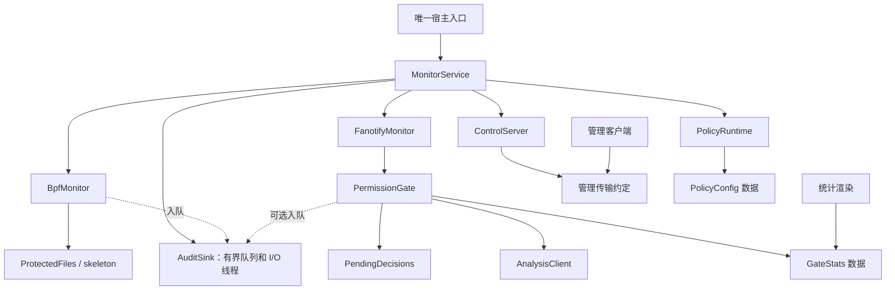

# 架构与可读性整理

本次检查覆盖手写用户态 C++ 模块、内核侧 BPF 模块及主要构建/测试入口。结论是：用户态已经采用面向对象的封装、组合与 RAII，适合继续演进；整体可读性仍有改进空间，不能仅凭文件短、类多或中文注释多就认定“很高”。这是一轮结构与所有权审查，不等于完整安全审计。

## 面向对象用在什么地方

| 原则 | 项目中的体现 | 判断 |
| --- | --- | --- |
| 封装状态与行为 | PermissionGate 管理权限门，PendingDecisions 管理队列，AnalysisClient 监督工作进程 | 各对象有相对清楚的状态边界 |
| 资源所有权 | OwnedFd、ProtectedFiles、ControlServer 与 skeleton 的作用域 | 应由类型和析构保证，减少调用者记忆负担 |
| 组合 | PermissionGate 组合队列和可选分析器，宿主组合策略运行状态与管理端 | 当前比建立继承树更直接 |
| 可替换行为 | PendingDecisions 的回复回调、PolicyRuntime 的提交回调 | 回调已经满足现有需求，暂不需要为每个模块增加虚基类 |
| 值对象与数据模型 | PolicyConfig、GateStats、协议请求/响应 | 保留简单 struct 合理；在解析/协议边界验证约束，避免大量无意义 getter/setter |
| 内核侧组织 | eBPF 文件按执行审计、凭证、文件保护、任务保护拆分 | 保留 C、helper 与 Map 的模型，避免将用户态 C++ 对象模型强搬到 BPF |

继承与运行时多态并不是衡量本项目面向对象程度的必要条件。后续若实际出现多个具有相同契约的分析后端，再评估接口抽象；目前用单一实现配虚接口会增加阅读跳转。

## 本轮实际整理

### 管理端的三个边界

原来的 control.cpp 同时包含服务端生命周期、客户端请求和底层接收规则。本轮拆为：

| 模块 | 职责 |
| --- | --- |
| [control.h](../src/control.h) / [control.cpp](../src/control.cpp) | 服务端目录/socket 所有权、待连接状态、命令分发 |
| [control_client.h](../src/control_client.h) / [control_client.cpp](../src/control_client.cpp) | 客户端请求、响应验证与 CLI 输出 |
| [management/channel.h](../src/management/channel.h) / [channel.cpp](../src/management/channel.cpp) | 共用地址构造、SO_PEERCRED、严格无附件接收 |
| [management/protocol.h](../src/management/protocol.h) / [protocol.cpp](../src/management/protocol.cpp) | 消息布局、枚举与字段验证、JSON 渲染 |

纯客户端调用方不再包含 ControlServer。channel 只借用连接 FD，不拥有后端资源；收到意外 SCM_RIGHTS 时仍关闭全部已安装的附件 FD。客户端和服务端继续执行相同的底层接收规则，避免未来修复一侧遗漏另一侧。

### 将资源所有权交给类型

[ProtectedFiles](../src/file_policy.h) 原先使用 vector<int>，通过手写析构循环 close；本轮改为 vector<OwnedFd>。候选准备失败、提交后旧集合析构和正常退出都由元素类型自动关闭 FD。转移使用 std::move，能够直接看出所有权去向；析构顺序和完整 Map 替换合同保持原有设计。

[AnalysisClient](../src/analysis/client.cpp) 内部增加局部 SpawnActions RAII 类型。posix_spawn_file_actions_init/destroy 成对管理，动作准备期间即使字符串分配等 C++ 操作抛异常，也会释放已经初始化的动作表。这个实现细节只存在于本文件，没有增加公共接口层。

ControlServer 与 PolicyRuntime 显式禁止复制，让服务资源和运行实例状态的所有权直接体现在接口上。PolicyRuntime 的活动配置可按 const 引用读取，但整个协调器不能被复制为第二个具有同一实例信息的对象。

### 单主服务的组合关系

主服务现已统一为 MonitorService；BpfMonitor 与 FanotifyMonitor 分别封装模块资源。main 只处理动作和顶层错误，两个模块不各自运行第二个策略服务；文件操作辅助进程仍独立隔离，决策与管理由同一主循环协调。两阶段提交和运行边界见 [单服务结构](UNIFIED_SERVICE.md)。

### 统计数据与权限门分离

[gate_stats.h](../src/fanotify/gate_stats.h) 只描述统计值；[stats.h](../src/fanotify/stats.h) 只提供渲染入口。统计渲染不再因为 GateStats 的定义而引入 group、裁决队列和分析进程。status.h 对 PermissionGate 使用前置声明，只有实现文件需要完整定义。

图表示主要职责关系，不是完整 include 图。ProtectedFiles 与 BPF skeleton 的析构顺序收束在 BpfMonitor::State 中，需结合 service 的成员顺序阅读；用 RAII 并不意味着可以随意调整对象声明顺序。

## 仍值得继续改进的地方

- 配置读取现已移到 policy/source.cpp，policy_config.cpp 只分派字段；policy/fields.h 提供无副作用基础读取，FanotifyFields 分开单行读取和最终模式约束。语法错误包含行号，后续扩展字段应继续保持此边界。
- 已完成唯一 main 与 MonitorService 的拆分；继续增加部署/恢复功能时，应保持模块准备/提交接口，避免把业务细节集中回协调器。
- 策略容量、配置大小和路径长度已集中到 include/secmon/policy_limits.h，内核模板、解析、候选和管理校验引用同一来源，仍保留各边界检查。
- 部分条件、参数校验和错误构造仍采用较长表达式，命名空间与格式也未完全统一。宜在修改相关模块时整理，避免一次性机械格式化掩盖重要语义差异。
- 错误处理分为配置语法异常、系统调用错误和管理业务错误，边界基本存在，但异常类型与命名还可更一致。整理时必须保留拒绝策略、错误回退和已有协议含义。
- 测试工具存在模块间相互导入和局部重复。继续扩展专题时，可以将真正共用的生命周期工具下沉到 harness；避免为了减少几行代码而建立复杂测试框架。

## 建议阅读顺序

先看“资源由谁拥有”，再看“谁调用谁”：OwnedFd → ProtectedFiles/ControlServer → PendingDecisions → AnalysisClient → PermissionGate → FanotifyMonitor/BpfMonitor → MonitorService → main。随后读管理客户端与纯配置/协议函数，最后结合 BPF Map 和 LSM 钩子观察内核侧语义。

注释优先解释为什么选这个 hook、何时转移 FD、失败保留什么状态、哪些操作只是在本层放行。类型和函数名应承担通常的代码含义，避免每行都重复直译。整体入口见 [代码导读](CODE_GUIDE.md)。

## 首次结构整理的历史验证

以下记录对应 2d69de6，当时仍有两个监控程序；当前单服务结构另见 [单服务导读](UNIFIED_SERVICE.md)，不把以下历史通过结果作为新结构的验证证据。

结构实现提交为 2d69de6。普通构建 20 项 CTest、25 个头文件独立编译和四程序生产构建通过。固定可执行快照的 22 个权限专题与八项各 10 秒负载共 30 项通过，覆盖管理协议/旧客户端、异常附件与 FD 回收、策略完整切换、授权撤销、分析器故障回退和两层组合。

一次中间回归与同目录重新链接重叠，发生可执行文件替换窗口中的启动失败；该轮未记作完整通过。构建收尾后复制到 build/structure-checkpoint 重跑，完整汇总 passed=true。原始日志为本机 /tmp/secmon-structure-final-root.log，无特权测试为 /tmp/secmon-structure-final-tests.log。该验证不将先前 15 分钟授权长测记为本次重构的重新执行，也不包含单独的 spawn 分配故障注入。

统一入口后的审计出口另拆为纯编码、C 回调和 AuditSink；I/O 线程只消费队列，不访问 PolicyRuntime 或 fanotify 裁决。相关失败边界与已知诊断限制见 [审计出口](AUDIT_OUTPUT.md)。

2026-10-23新增的可选FUSE组件是文件视图提供者，不是另一套安全服务。它复用既有inode策略及响应，只引入libfuse依赖和有界回调，未增加内核Map/安全IPC/管理ABI。当前并未纳入MonitorService的子进程监督；补齐生命周期时须围绕现有候选准备/提交合同，明确就绪、死亡、路径等待与同路径不同挂载的身份，而非只按PID或字符串自动重绑。详见[虚拟视图合同](VIRTUAL_DECOYS.md)。

## 后续所有权增量（2026-10-26）

权限门现组合EventReader：真实文件留在读取子进程，主队列仅持有代理，分析FD直接发给降权扫描器，裁决仍由主服务完成。MonitorService可另持有DecoyProvider，先获得视图Ready，再固定政策对象，最后按资源依赖停止视图。这些对象沿用组合和RAII，没有增加策略继承树或独立管理服务；路径及资源图见[代码导读](CODE_GUIDE.md)。进度探测及局部等待有界不等于所有内核VFS等待可取消，也不等于已有自动重绑定或持久防护。
