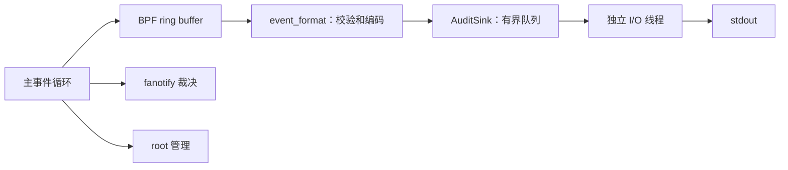

# 有界审计出口与主循环公平性

主进程同时承载 BPF 与 fanotify 后，审计 JSONL 不能再直接写阻塞 stdout。否则日志读端停住，安全裁决和 root 管理也会一起等待。本模块把格式转换、排队和实际 I/O 分开；它没有创建另一个监控进程。



| 文件 | 负责什么 |
| --- | --- |
| [event_format.cpp](../src/event_format.cpp) | 复制未对齐二进制记录，校验当前 ABI/长度/种类，按字节转义并生成单条 JSONL；没有 I/O |
| [events.cpp](../src/events.cpp) | libbpf C 回调边界：尝试入队，格式错误或分配异常只更新计数，不跨 C ABI 抛异常 |
| [audit_sink.h](../src/audit_sink.h) / [audit_sink.cpp](../src/audit_sink.cpp) | 输出引用、队列、I/O 线程、完整/丢弃/错误计数和退出 |
| [audit_limits.h](../include/secmon/audit_limits.h) | 最大 1024 条、1 MiB、单条 4096 字节的统一边界 |

队列包含正在写出的头部记录，按完整字符串长度记有效字节预算；对象/分配器和线程栈另有开销，该预算不是整个进程堆内存峰值。生产者只在短临界区检查/追加，写线程在 write/send/poll 期间不持队列锁；队列满、超过预算或出口离线时丢弃新记录，并报告 audit_dropped。启用 BPF 时 stdout 专用于该出口，其他主服务模块不能再绕过队列写 std::cout。主循环每次最多消费 128 条 BPF 记录，避免持续审计洪流一直占用执行权而饿死 fanotify 或管理。

## 输出引用与失败行为

对管道和字符设备，通过 `/proc/self/fd` 重新打开独立的非阻塞输出描述，不对原来的 stdout 使用 F_SETFL。因为简单 dup 后修改 O_NONBLOCK 会改变共享 open-file-description，可能影响父进程或其他使用者。普通文件在 I/O 线程复用原 open-file-description，保留共享偏移、O_APPEND/O_SYNC 等原有语义，不把所有输出强制覆盖到文件头，也不改变继承的状态标志。

socket 无法通过 proc 重新打开，因此也复制 FD，每次 send 使用 MSG_DONTWAIT/MSG_NOSIGNAL。管道写线程单独屏蔽 SIGPIPE，断开记录 EPIPE，不修改整个进程的信号处理，也不把安全服务意外终止。出口发生永久错误后不自动重开，后续记录计为丢弃，BPF/fanotify 仍继续执行规则。

正常停止先关闭 BPF 事件来源、消费剩余 ring 记录，再给非阻塞出口约 200ms 排空；超时剩余条目计为丢弃。流式输出若在部分写入后断开，末尾可能是不完整行；完整写出计数只在整条记录完成后增加，不声称崩溃/断开后日志总是完整。

普通文件的 O_NONBLOCK 不能保证底层存储 I/O 本身不等待；独立 I/O 线程隔离主循环，但存储故障时 join 仍可能受影响。stderr 的启动/诊断和周期统计当前仍是同步输出，本模块没有宣称隔离所有诊断背压。正常部署应让诊断出口持续可写；进一步统一诊断 I/O 属于后续工作。

## 管理状态与计数口径

启用 BPF 的状态（bpf/combined）包含：

| 字段 | 含义 |
| --- | --- |
| audit_written | 完整写出的用户态 JSONL 条数，不代表消费端已持久化 |
| audit_dropped | 用户态队列/预算拒绝、分配失败、出口离线及停止未排空记录 |
| audit_invalid | 从 ring 收到但因长度/布局/种类不合契约而拒绝的记录 |
| audit_queued | 当前仍持有的记录数，包含正在写出的头部，最多 1024 |
| audit_errno | 已观测输出错误，0 表示尚未发现永久错误；不是消费端健康保证 |

这些计数与内核 ringbuf_dropped 不同：记录可能在内核就丢失，也可能进入用户态后因输出背压丢失。不能只看一个计数便宣称审计完整。状态复制队列/线程最近已观测数据，查询不等待消费端、不重新打开出口。

## 验证

```bash
ctest --test-dir build --output-on-failure
sudo python3 tests/run_privileged.py --build-dir build --only audit-backpressure shutdown-order management-faults
```

无特权测试使用真实管道、socketpair 和普通文件，验证队列边界、恢复、有限等待退出、SIGPIPE 隔离、输出标志/位置/追加语义及多生产者回复对账。格式测试覆盖错误 ABI、未对齐记录、最大转义长度和控制字节。

权限专题使用缩小到 4096 字节且无人读取的 stdout 管道，制造真实文件拒绝事件，仍检查 fanotify 允许/拒绝、联合重载、授权停止；另验证读端恢复、关闭及持续洪流。它允许产生可观测审计丢失，不将丢失误报为安全策略放行。

停止时序另由 shutdown-order 验证：在结束统计之前先关闭 fanotify 组，诊断背压即使拖慢进程退出，也不继续持有无人处理的权限等待。
