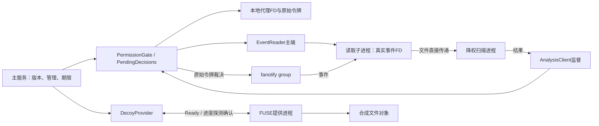

# 代码导读

架构、面向对象与资源所有权的评估见 [结构整理说明](ARCHITECTURE_REVIEW.md)。建议先阅读 README 的运行边界，再按下面的顺序研究代码。当前代码围绕执行与凭证、文件/保险箱策略、自保护，以及fanotify和诱饵模块组织。

## 宿主程序：从参数到事件

| 文件 | 职责 | 阅读重点 |
| --- | --- | --- |
| `src/decoy/main.cpp` / `provider.cpp` | 合成视图及可选托管监督 | 主服务等Ready后固定inode；独立模式保留；托管循环同时处理FUSE与进度探测 |
| `src/fanotify/event_reader.h/.cpp` | 真实事件文件FD隔离及进度 | 读取者持有文件、主队列持有代理，文件直接传扫描器；内核裁决仍由主进程负责 |
| `src/options.h` / `src/options.cpp` | 参数解析和互斥校验 | `Options` 保存配置；`CliAction` 区分运行、帮助、停止和重载；解析过程不访问 BPF 或 socket |
| `src/main.cpp` / `src/service.cpp` | 唯一入口与主服务协调 | main 处理参数/管理动作，MonitorService 持有两模块、一个运行策略、管理端和统一 stdout 审计出口 |
| `src/bpf/monitor.cpp` / `src/fanotify/monitor.cpp` | 两个模块对象 | BPF 拥有 skeleton/Map/ring，fanotify 拥有权限门；不各自拥有主循环或进程 |
| `src/event_format.cpp` / `src/events.cpp` | ABI/JSONL 纯编码、回调入队和内核统计 | 校验长度/布局/种类，C 回调不抛异常；每 CPU 统计逐 CPU 求和 |
| `src/fanotify/audit.h/.cpp` | 权限回复的 JSONL 编码 | 请求携带接收时的身份/revision，成功写回后编码；不重新解析路径或查询 PID |
| `src/audit_sink.h/.cpp` | 有界审计出口 | 主循环只入队，I/O 线程写 stdout；背压和出口错误计数可查询 |
| `src/diagnostic_output.h/.cpp` | 服务期的独立 stderr 出口 | 将 cerr 和 libbpf 日志按完整行送入独立预算的 AuditSink；快照保持无效/丢弃计数一致，flush 不等待实际输出 |
| `src/owned_fd.h` | 文件描述符 RAII | 禁止复制，析构时关闭 FD，避免重复关闭 |
| `src/policy_config.h` / `src/policy_config.cpp` | 配置值模型和纯字段分派 | 严格唯一字段集合、运行 revision、错误行号；不访问文件系统 |
| `src/policy/source.cpp` / `src/policy/fanotify_fields.cpp` | 安全读取与 fanotify 值构建 | 前者固定/复核来源并计算摘要，后者区分静态/分析字段约束 |
| `include/secmon/policy_limits.h` | C/BPF/C++ 共用边界 | 模板、解析、候选与管理校验使用同一容量定义 |
| `src/file_policy.h` / `src/file_policy.cpp` | 固定文件对象并完整切换 Map 策略 | 候选 HASH 填满后切换外层 Map 引用；失败保留旧策略与 inode FD；退出时当前句柄比链接活得更久 |
| `src/control.h` / `src/control.cpp` | root 管理服务端 | 私有目录 FD 固定创建与清理位置；`SO_PEERCRED` 验证身份；完整 `stop` / `reload` 消息；操作完成后确认 |

`src/control_client.h/.cpp` 单独提供管理客户端；`src/management/channel.h/.cpp` 共用地址、对端身份和无附件接收规则。`src/fanotify/gate_stats.h` 是不依赖权限门实现的统计模型。

头文件暴露接口与资源所有权，系统调用和协议细节放在对应 `.cpp`。`MonitorService` 通过这些接口协调运行，避免再次把各个功能实现堆回入口。

正常退出时先处理 fanotify 已交付请求并停止分析器，再 detach BPF、消费剩余审计事件、排空服务拥有的统一出口后报告统计。异常退出依赖对象逆序析构；BpfMonitor 内部按 ring buffer、skeleton、固定 inode 集合释放。研究资源顺序时应同时读服务成员与模块成员的声明。

## 内核侧：跟踪一次执行

1. 阅读 `eBPF/secmon.h`：这是用户态与内核态共同使用的事件 ABI 和常量定义。
2. 阅读 `eBPF/secmon.bpf.c`：共享 ring buffer、统计 Map，以及执行检查和执行完成事件。
3. 阅读 `eBPF/upchk.bpf.c`：凭证基线、fork/exec/exit 生命周期和异常标记。基线只是观测记录，不代表凭证变化得到授权。
4. 阅读 `eBPF/fileguard.bpf.c`：文件身份匹配、各个 LSM 钩子与拒绝事件。
5. 阅读 `eBPF/selfguard.bpf.c`：任务本地存储、线程组目标身份、信号与 ptrace 拒绝。

这些 `.bpf.c` 模块由 `secmon.bpf.c` 包含，编译成一个 BPF 对象，以共享 Map 和辅助函数。它们不是单独链接的用户态源文件。修改模块后，CMake 的依赖规则会重新编译对象并生成 skeleton。

一次普通 exec 通常会产生检查和完成事件。脚本可能经过多次检查，失败的执行也可能只有检查事件。非主线程 exec 可能改变 TID，需结合 `old_tid`、任务身份及事件顺序理解，不能仅按检查事件数量统计成功次数。

## 构建产物与验证

`CMakeLists.txt` 描述两条构建链：本机 BTF → `build/vmlinux.h` → BPF 对象 → skeleton，以及 `src/*.cpp` → 宿主可执行文件。生成文件留在构建目录，不应手动修改或提交。

```bash
cmake -S . -B build
cmake --build build -j
ctest --test-dir build --output-on-failure
./build/secmon --check
```

CTest 的 `cli-validation` 检查非法参数的退出码为 2，覆盖缺失值、时长格式/范围、选项冲突与 257 个文件；这些路径在加载 BPF 前退出。其余用例验证帮助输出和执行场景工具，不验证防护是否实际生效。

完整内核行为需要管理员权限：

```bash
sudo python3 tests/integration.py --build-dir build
sudo python3 tests/self_protection.py --build-dir build
```

阅读测试时，先看 `tests/scenarios.cpp` 如何制造执行和线程场景，再看两个 Python 脚本如何启动服务、验证事件和清理。测试操作范围及防护边界以 README 为准。

## 后续研究方向

现已在统一主进程内提供固定多目标 fanotify 裁决，源码位于 `src/fanotify/`，详见 [fanotify 学习实验](FANOTIFY_LAB.md)。已加入接收后的请求超时、用户态并发预算和对应实验；后续可研究真实内核队列溢出，继续扩展现有联合策略。fanotify 不能作为所有写入操作的通用阻断入口；详细设计和已验证范围见 `DESIGN.md`。

同时研究两个策略模块时，可参照 [策略组合实验](POLICY_LAYERS.md) 的状态矩阵，区分单层退出与所有防护退出。

研究凭证基线时，可参照 [凭证生命周期实验](CREDENTIAL_LIFECYCLE.md)，在受控阶段直接观察 Map 中的线程身份与凭证值。

完整检查可以通过 [测试矩阵](TESTING.md) 中的统一入口运行，按专题选择实验。


## 建议的研究练习

1. **先预测，再看事件。** 阅读 `tests/credential_transitions.py` 的普通/setuid/setgid/file-capability/user-namespace 设置，分别写下检查点和完成点应有的 UID、EUID 与 caps；运行后与实际报告对照。特别观察为什么检查点的 `target_euid` 不适合作为最终权限预测。
2. **跟踪一个线程的 key。** 阅读 `tests/lifecycle_scenario.cpp` 的四个等待线程，再沿 `upchk.bpf.c` 的 fork、exit、prepare_exec 和完成路径追踪 key。用 `baseline_lifecycle.py` 观察 join 与非主线程 exec 前后的实际集合，区分旧 TID、线程组 PID 和启动时间。
3. **手算一次截止时间。** 对一个接收于 0 ms 的请求，分别设置 delay/timeout 为 10/20、20/20、30/20 ms，再考虑循环直到 25 ms 才被调度的情况。对照 `tests/decisions.cpp`，检查为何迟到时超时优先，poll 为何对不足 1 ms 的剩余时间向上取整。
4. **画出资源释放顺序。** 从 `PermissionGate` 的成员声明与 `OwnedFd` 移动操作出发，检查待裁决 FD、组 FD、固定 inode FD 谁先关闭。再看回复失败时异常展开如何释放资源，以及为什么“关闭事件 FD”不能代替向内核回复权限决定。
5. **区分几个容易混淆的覆盖面。** 对照 `fanotify_events.py` 预测 open、read、mmap、直接执行和解释器读取的结果，再看 `policy_composition.py` 中停止一层后的已有 FD 写入。把“操作被拦截”“任务被隔离”和“内容能恢复”分开列证据。

建议每次只改变一个实验参数，先使用测试自建的临时文件和内部期限。观察结论写在自己的笔记里；不要把本机一次通过扩大成所有文件系统、容器或攻击场景的保证。

独立内容分析的协议、降权和 FD 生命周期见 [分析组件导读](ANALYSIS_WORKER.md)。先比较静态队列与外部分析模式，再研究超时后的子进程终止。


研究独立分析组件时，可以先按 `protocol.h` 的 ID 与 Ready 约束追踪一次请求，再看 `client.cpp` 如何把后端故障与权限拒绝分开，最后运行 `analysis_protocol.py` 和 `fanotify_analysis_faults.py` 对照异常分支。`analysis_allocation.cpp` 的分配故障钩子只存在于独立测试程序，适合研究系统调用取得资源后 C++ 异常安全的要求；不要把它加入正式程序。

文件策略的配置格式、切换顺序和资源所有权详见 [策略配置导读](POLICY_CONFIG.md)。

`src/fanotify/policy.h/.cpp` 负责共享格式到 fanotify 运行类型的转换，及不能在线变更的 mark/分析器身份比较。共享的 `policy_config` 与 `control` 模块供唯一主服务使用；fanotify 的 prepare 仅在已交付请求队列与分析器空闲时通过，commit 是验证后的无异常提交。


## 有内核监控经验时如何读这些中文注释

手写的内核代码、宿主、分析器、测试和构建脚本均提供中文入口说明；关键接口旁进一步说明数据流、资源所有权和边界。建议按以下路径阅读：

1. [共享 ABI](../eBPF/secmon.h) → [BPF 总入口](../eBPF/secmon.bpf.c)：先认识 BTF/CO-RE、SEC、Map、helper 和 verifier，再跟踪 reserve → 填充 → submit → [用户态 consume](../src/events.cpp)。
2. [BPF 模块生命周期](../src/bpf/monitor.cpp)：对照传统内核模块的初始化/退出，区分 skeleton open、内核 load/verifier、attach 和 detach，关注固定 inode 与链接的释放顺序。
3. [凭证记录](../eBPF/upchk.bpf.c) → [文件保护](../eBPF/fileguard.bpf.c) → [任务保护](../eBPF/selfguard.bpf.c)：分别看观测钩子、可拒绝的 LSM 钩子，以及 task 指针为何要保留 verifier 类型信息。
4. [fanotify 权限门](../src/fanotify/gate.cpp) → [裁决队列](../src/fanotify/decisions.cpp)：区分 group、inode mark 和事件 FD，追踪请求方等待 → 读取事件 → 排队/分析 → 写 response → 关闭 FD。
5. [分析器监督](../src/analysis/client.cpp) → [FD 传输](../src/analysis/transport.cpp) → [工作进程](../src/analysis/worker_main.cpp) → [扫描器](../src/analysis/scanner.cpp)：理解 SCM_RIGHTS 转交对象引用、降权顺序、Ready 握手、超时与错误回退。
6. [共享配置](../src/policy_config.cpp) → [Map 策略提交](../src/file_policy.cpp) → [fanotify 配置适配](../src/fanotify/policy.cpp)：比较 BPF 候选 Map 一次切换与 fanotify 空队列更新的不同前提。

注释会明确区分“收到日志”和“作出拒绝”、“观察到凭证变化”和“授权凭证变化”，以及“用户态队列满”和“内核事件丢失”。这些差异直接决定监控结果能说明什么。

`eBPF/vmlinux.h` 和 `eBPF/secmon.skel.h` 是仓库中保留的生成文件，本轮不逐项手工注释。当前构建实际从本机 BTF 和新编译的 ELF 在 `build/` 生成对应文件，并优先包含该目录。前者可查结构体布局，后者可查生成的程序/Map 管理接口；生成原理见 [CMake](../CMakeLists.txt) 和 [bpftool 包装](../cmake/Bpftool.cmake)。第三方 libbpf 实现也保持原样。

活动状态与重载结果现在由 `src/policy_runtime.h/.cpp` 统一管理，管理响应 ABI/JSON 在 `src/management/protocol.h/.cpp`，fanotify 的快照适配在 `src/fanotify/status.h/.cpp`。详见 [管理接口](MANAGEMENT.md)，查询与事件处理在同一循环中串行运行。

`src/content_digest.h/.cpp` 通过系统 OpenSSL EVP 为原始配置字节计算 SHA-256，活动状态复制已提交的摘要。配置、摘要、版本和管理协议编入纯用户态公共静态库 `secmon-policy`，不包含 BPF/fanotify 挂载动作。

`src/fanotify/stats.h/.cpp` 统一输出累计裁决统计及原因拆分，`analysis::ScanError` 在分析协议中定义。管理状态复用同一份 GateStats，避免末次日志与实时查询出现两套计数口径。

`secmon-policyctl` 的入口 src/management/main.cpp 只读查询一个服务，检查是否配置及可选预期 revision；不再保留跨进程四快照比较。完整启动/联合重载阅读路径见 [单服务结构](UNIFIED_SERVICE.md)。

## 同包构建与运行策略编号

| 名称 | 当前含义 |
| --- | --- |
| 配置格式 | 唯一字段集合，没有 version 指令；未知字段直接拒绝 |
| 配置 revision | 管理者指定的正 uint64，当前实例内成功重载必须递增 |
| 管理响应 ABI | 唯一完整布局，固定大小与标识检查，不返回历史前缀 |
| 分析器 ABI | 同包宿主/工作进程必须匹配，错误时隔离后端，不做降级 |
| BPF 事件 ABI | skeleton 嵌入同包 BPF；宿主仍检查当前事件布局 |

组件绑定交付，构建与测试负责同步接口；布局标识只用于检错，不提供版本兼容。配置 SHA-256 核对原始字节，不是程序签名或策略 revision。具体契约见 [管理接口](MANAGEMENT.md)。


### 程序对象授权

[src/writer_identity.cpp](../src/writer_identity.cpp) 固定 root 所有的执行文件对象，[eBPF/writer_identity.bpf.c](../eBPF/writer_identity.bpf.c) 在文件操作时匹配当前 mm 的执行对象和有效 UID。它与目标保护共用一份候选 Map；先阅读 [授权边界](WRITER_IDENTITY.md)，区分对象匹配与完整可信应用识别。

## 从函数内注释串起三条完整路径

本轮进一步在手写源码/头文件中补充函数契约、参数单位、资源转移与失败语义，不只提供文件顶部的模块说明。可以选一条路径顺序读，遇到陌生接口就看紧邻调用处的注释：

1. **内核拒绝路径**：[fileguard.bpf.c](../eBPF/fileguard.bpf.c) 的 `guard_inode_policy` → [writer_identity.bpf.c](../eBPF/writer_identity.bpf.c) 的 `authorized_writer` → ring buffer 拒绝事件。注意目标集合查询未命中与调用主体查询未命中含义不同；辅助函数的逻辑 0 也不同于 LSM 的放行返回值。先理解 Map 同一快照，再看 rename 的两个操作数。
2. **fanotify 请求路径**：[gate.cpp](../src/fanotify/gate.cpp) 的 `poll_once` → [decisions.cpp](../src/fanotify/decisions.cpp) 的 `submit`/`next_request` → [client.cpp](../src/analysis/client.cpp) 的 `track_submission`与读取者派发 → [worker_main.cpp](../src/analysis/worker_main.cpp) → [scanner.cpp](../src/analysis/scanner.cpp) → `service_analysis`/`complete`/`respond`。沿途区分主进程代理句柄、读取者原始FD令牌、直接传给扫描器的SCM_RIGHTS引用、请求ID及期限；主进程不关闭真实事件文件，实际释放由读取者处理。
3. **策略替换路径**：[policy_runtime.cpp](../src/policy_runtime.cpp) 的 `reload` → [policy_config.cpp](../src/policy_config.cpp) 的 `load_policy`/`parse_policy` → [file_policy.cpp](../src/file_policy.cpp) 的 `install` → 外层 Map 引用切换 → 活动配置移动赋值。分别看配置读取失败、候选准备失败和成功提交后的状态变化；不要把候选日志当作活动策略已经切换。

接口旁也补充了返回值的边界：`poll_once(false)` 不等于后端离线，`receive_packet(ready)` 不等于协议合法，`scan(allow)` 不等于恶意内容识别完成，`snapshot` 不会主动探测分析器。生成的 vmlinux.h、skeleton 和第三方代码仍按生成/供应方来源阅读，学习入口优先选择手写源码。

主进程的审计入口每轮限量消费，输出经 AuditSink 有界排队；线程不修改运行策略。stdout 背压、错误与停止行为见 [审计出口](AUDIT_OUTPUT.md)。

保险箱会话沿用 `file_policy` 的候选及 root 重载；`boot_clock` 统一全局启动时钟坐标，`secmon-vault-session` 生成包含启动标识及绝对签发时间的配置行。语义和验证见 [保险箱会话](VAULT_SESSIONS.md)。


## 虚拟诱饵阅读入口（2026-10-23）

先读[视图合同](VIRTUAL_DECOYS.md)，再看 `src/decoy/main.cpp`。它使用 libfuse low-level API 固定 inode/目录偏移，直接回复合成内容，不转发业务文件，不把 FUSE 请求 PID 发给安全服务。随后沿 `pin_policy_file` → `ProtectedFiles` → `guard_inode_policy_detail` → 原有 response 跟踪真实设备/inode如何复用既有安全底座。

验证先读 `decoy_view.py` 的无特权文件系统对照，再读 `virtual_decoy.py`、`virtual_decoy_lifecycle.py` 和 `virtual_decoy_fanotify.py`，最后看单视图/单联合服务的 `virtual_decoy_soak.py`。该节对应独立首版。后续已可由MonitorService显式托管启动、就绪与进度；当前仍不具备自动重挂载/目标重新绑定，见[托管合同](MANAGED_DECOYS.md)。


## 隔离进程与所有权（2026-10-26）



图表示通信及资源分工，不是额外安全策略服务。进度/派发/清理均有固定预算；主队列接收之前的事件不具有端到端期限。正常析构最后停止托管视图，保证原有策略和订阅先释放对象引用。主入口先恢复SIGCHLD可回收状态，再启动辅助进程；`child_startup_cleanup.cpp`只在独立测试中包装系统调用，验证pidfd分配失败仍能清理自有子进程。

建议按[静态读取](STATIC_EVENT_READER.md)→[分析文件直传](ANALYSIS_EVENT_READER.md)→[进度监督](READER_HEALTH.md)→[辅助自保护](HELPER_PROTECTION.md)→[托管视图](MANAGED_DECOYS.md)阅读。`secmon-policyctl --require-ready/--require-decoy`只消费同一份已验证状态，不产生第二份策略或恢复循环。

## 2026-10-28新增入口

- `src/vault/main.cpp`、`policy_edit.cpp`、`policy_file.cpp`：root保险箱操作、共享语法候选和可信来源发布；权限仍由已有Map执行，结果不确定时不回写旧策略。
- `src/decoy/mount_identity.cpp`：内核唯一ID、拓扑与祖先文件系统检查；覆盖检测不是挂载拒绝策略。
- `src/service_notify.cpp`及`packaging/secmon.service.in`：可选前台就绪/停止通知和只随文档交付的模板。
- `src/fanotify/reader_error.h`及gate/monitor：指定读取者失败保留原group与BPF，原即时allow合同下显式换组恢复。

当前管理布局为同包v11/528字节。完整目标、实测缺口和下一步顺序以[当前状态](STATUS_2026_10_28.md)为准。
