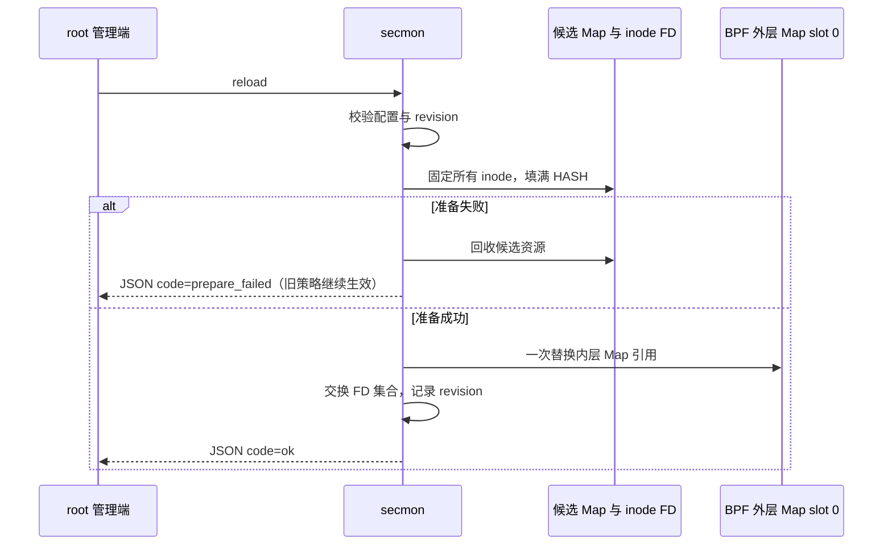

# 文件策略配置与在线切换

本模块提供一套共享配置字段，包含 BPF 文件保护/执行对象授权和 fanotify 裁决设置。一个主服务的两个模块应用对应字段，通过共用 revision 管理在线更新顺序。组件绑定发布，不维护历史配置格式，配置中没有 version 指令。

## 运行示例

把 [示例文件](../examples/file-policy.conf) 中的路径改成已存在的普通文件，再以 root 所有、0600 权限保存为 `/run/secmon/policy.conf`。管理目录使用 root 所有的 0700 目录。

```bash
sudo install -d -m 0700 /run/secmon
sudo ./build/secmon --policy /run/secmon/policy.conf \
    --self-protect /run/secmon/control.sock
# 另一个终端：以新文件原子替换配置，递增 revision，再执行：
sudo ./build/secmon --reload /run/secmon/control.sock
sudo ./build/secmon --stop /run/secmon/control.sock
```

`--policy` 与 `--protect-file` 互斥。没有 `--control` 或 `--self-protect` 时也能加载配置，但没有管理 socket，不能在线重载。`--reload` 只发送命令，服务始终重新读取启动时指定的配置路径；客户端不能指定另一个配置文件。

服务完成切换后回复结构化结果；CLI 输出 JSON，成功 code=ok，拒绝则带稳定错误码并非零退出，详细原因写服务的 stderr。停止和查询使用同一响应格式。连接中断或客户端等待超时不代表切换一定没有发生，应检查服务的 `Policy active revision=N` 记录。重试相同版本会被拒绝。

## 格式

```text
# 整行注释；空行忽略
revision 2
protect "/absolute/path/file with spaces"
protect "/another/file"
```

- 配置只接受当前字段集合；旧 `version` 指令和其他未知字段都拒绝，不自动转换。protect、allow-writer 和 fanotify 字段可以在同一份配置中使用。
- `revision` 是非零 uint64 十进制数，恰好一次；在线更新必须严格大于当前运行版本。允许不包含 `protect` 的配置，在没有 writer 时表示解除全部文件保护。
- `protect` 必须使用双引号和绝对路径。采用 C++ `std::quoted` 的转义规则：`\"` 表示双引号，`\\` 表示反斜杠；它不是 JSON，`\n` 不表示换行。不支持行尾注释、未知键、重复路径、NUL 或跨行字符串。
- 最多 256 条路径，单条最长 4095 字节；配置最多 64 KiB。硬链接别名可占多条路径，内核只保留一个 inode 键；容量按路径条数计算。
- 配置必须是 root 所有且组/其他用户不可写的普通文件，拒绝末尾符号链接。以非阻塞方式打开，避免错误指向 FIFO 后卡住服务。读取前后比较 size/mtime/ctime，拒绝观测到的并发修改。建议在可信私有目录中用同目录临时文件加 rename 原子发布，不原地写配置。

父目录和路径中间组件不采用逐级 `openat2` 限制，不保证配置是不可变快照。配置签名、持久防回滚与可信发布者身份尚未实现；进程重新启动后不会记住此前最大 revision。

## BPF 候选 Map 如何完整切换

1. `policy_config.cpp` 读取并完整解析候选配置，当前版本不变。
2. `file_policy.cpp` 创建新的 320 项 HASH Map，为所有目标持有 `O_PATH` FD，并填充新 Map。任一步失败由候选对象析构回收资源，旧 Map 不变。
3. 所有准备完成后，用一次 `bpf_map_update_elem` 将 `protected_files` ARRAY_OF_MAPS 的 slot 0 替换为新 Map。
4. 外层 Map 持有新 Map 的内核引用，宿主交换固定文件 FD 集合，释放旧集合，再更新运行版本并确认请求。



每次文件保护钩子获取一个完整 Map；rename 的源和目标共用同一个 Map 引用。在途钩子可能继续使用旧 Map，由内核维护引用生命周期。因此不把切换解释为所有在途系统调用的同步屏障：一个系统调用经过多个 LSM 钩子时可能跨越版本。审计事件 ABI 仍为 v4，没有新增 policy revision 字段。

首次启动仍然逐个 attach LSM 程序，不承诺所有钩子原子启用。退出与崩溃仍解除未固定的 BPF 链接。临时准备期间最多额外持有 320 个文件 FD 和一份候选 Map；重复成功与失败重载不应累计持有资源。

## 阅读与验证

建议按 `src/policy_config.h/.cpp` → `src/file_policy.h/.cpp` → `eBPF/fileguard.bpf.c` → `src/control.h/.cpp` → `src/bpf/monitor.cpp` → `src/service.cpp` 阅读。配置解析、文件对象和 Map 所有权、root 管理通道、生命周期协调各有独立职责。

```bash
ctest --test-dir build --output-on-failure
sudo python3 tests/run_privileged.py --build-dir build --only policy-reload
```

解析测试覆盖格式、数值溢出、重复与容量边界。真实 BPF 测试验证增加/移除、整份清空、拒绝未递增 revision、候选准备失败保留旧保护、配置权限、symlink 与 FIFO 拒绝、自保护服务的管理命令、反复切换时共同保护对象持续拒绝，已有写入 FD 在保护解除前后的变化、256 文件实际容量，以及 FD 数量回归。并发探测是回归证据，不是所有调度时序的形式证明。


## 共用配置与 fanotify 重载

[共用配置示例](../examples/unified-policy.conf) 包含 `protect` 和 `fanotify-*`，一条命令启用两个对象：

```bash
sudo ./build/secmon --policy /run/secmon/policy.conf --control /run/secmon/control.sock
sudo ./build/secmon --reload /run/secmon/control.sock
sudo ./build/secmon --stop /run/secmon/control.sock
```

MonitorService 只维护一份活动策略、一个管理通道。联合重载先检查 fanotify 固定后端和空闲状态，再准备并切换 BPF Map，随后执行不会抛异常的 fanotify 值提交，最后提交共用 revision。fanotify 检查失败或 BPF 准备/提交失败时两模块都保持旧策略。不同内核钩子和在途调用仍可跨越切换时刻，不承诺全局原子性。

使用 `--policy` 时不能混入 `--protect-file` 或逐项 fanotify 策略参数；可以指定管理 socket 和可选运行时长。未指定 --run-for 时服务持续运行。没有 fanotify 字段时默认仅运行 BPF；在线新增或移除 fanotify 模块必须重启。诊断用 --bpf-only/--fanotify-only 明确只运行指定模块，正常部署不需要分别启动。

| 字段 | 默认/约束 | 在线更新 |
| --- | --- | --- |
| `fanotify-file` | 必填，双引号绝对路径，现有普通文件 | 需重启 |
| `fanotify-event` | open；可选 open/access/exec | 需重启 |
| `fanotify-decision` | 静态模式必填 allow/deny；分析模式禁用 | 静态模式可更新 |
| `fanotify-analyzer` | 分析模式的双引号绝对程序路径 | 需重启；不能在线切换模式 |
| `fanotify-marker` | 分析模式必填，双引号 1..256 字节 | 需重启 |
| `fanotify-scan-limit-bytes` | 分析模式 65536，范围 1..1048576 | 需重启 |
| `fanotify-delay-ms` | 静态模式 0，范围 0..60000；分析模式禁用 | 可更新 |
| `fanotify-timeout-ms` | 250，范围 1..60000 | 可更新 |
| `fanotify-max-pending` | 64，范围 1..4096 | 可更新 |
| `fanotify-timeout-decision` | deny，可选 allow/deny | 可更新 |
| `fanotify-overload-decision` | deny，可选 allow/deny | 可更新 |
| `fanotify-error-decision` | 分析模式 deny，可选 allow/deny；静态模式禁用 | 可更新 |

每个 fanotify 字段最多一次。只有 `fanotify-file` 而没有静态裁决或完整分析设置会被拒绝；没有任何 fanotify 字段的配置可供 BPF 使用，但不能用于 --fanotify-only 诊断模式。

fanotify 的更新不关闭 group、不重建 mark、不重启分析进程。已交付请求队列或分析器仍有活动请求时拒绝重载，并保留原 revision，待请求处理完可重试同一候选版本。检查和切换发生在同一事件循环中。尚在内核队列中、切换后才读取的事件使用新设置；这不是按系统调用开始时间划分版本。

改变目标路径字符串、事件类型、后端模式、扫描器程序、标记或扫描上限需要重启，即使两个路径恰好指向同一 inode 也拒绝。保留的 mark 始终跟随原先固定的对象，不重新解析目标路径。后端离线后仍可更新错误回退，但不会借此自动重启分析器。

配置文件不能与 fanotify 目标是同一 inode，包括硬链接别名。启动在 mark 前比较身份；重载先以 O_PATH 固定配置，再检查与目标 inode 是否相同，通过后才通过 `/proc/self/fd` 打开所固定对象读取，防止路径替换绕过检查并产生自阻塞。O_PATH 不产生当前三类权限事件。其他服务监控该配置文件等跨服务依赖仍需由部署者避免。

## 新增学习入口与验证

`src/fanotify/policy.h/.cpp` 将共享格式转换成运行类型并校验不可在线变更的后端身份；FanotifyMonitor::prepare 通过 PermissionGate::validate_reconfigure 检查队列和分析器空闲，commit 只执行已验证的无异常赋值；两阶段之间不推进事件循环，避免改变旧请求合同。

`fanotify-policy` 权限专题使用单模块诊断实例验证共用字段格式、BPF 拒绝不被 fanotify 更新解除、静态裁决切换、忙队列拒绝后重试、固定后端变更拒绝、配置硬链接避免自阻塞、重复更新 FD 稳定，以及真实扫描器故障后的错误回退更新。原有无特权时钟测试验证被拒绝更新的请求仍按原时间与裁决处理。

## 程序对象修改授权

新增 `allow-writer "/absolute/program" EUID`，最多 64 条，与最多 256 条 `protect` 共用一份 320 项候选 Map。身份、撤销、代码保护及实验边界详见 [程序对象授权](WRITER_IDENTITY.md)。fanotify 仍只应用自己的字段，不按 writer 绕过裁决。

联合服务的对象所有权与提交时序详见 [单服务结构](UNIFIED_SERVICE.md)。
