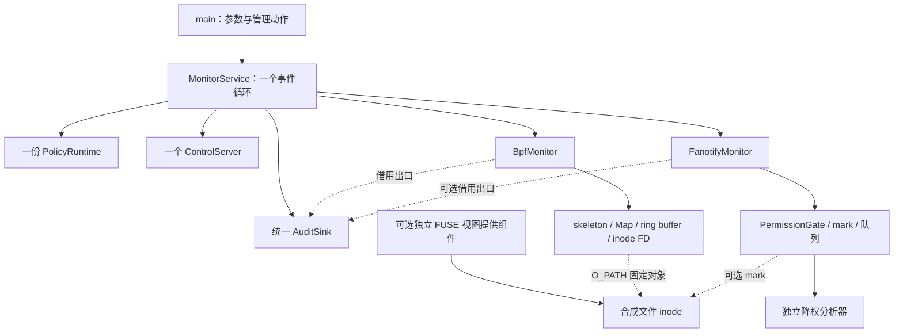

# 一个主服务、两个监控对象

`src/main.cpp` 是唯一监控服务入口。分析器、可选 FUSE 视图提供组件和命令行管理工具仍有各自的 main，但不拥有第二套监控策略或管理服务。



| 文件 | 负责什么 |
| --- | --- |
| [main.cpp](../src/main.cpp) | 解析动作；管理请求不加载模块；运行时创建服务对象 |
| [service.h](../src/service.h) / [service.cpp](../src/service.cpp) | 初始配置、信号、两个对象的寿命、联合重载、统一快照和退出 |
| [bpf/monitor.h](../src/bpf/monitor.h) / [monitor.cpp](../src/bpf/monitor.cpp) | 本机检查、skeleton open/load/attach、策略 Map、事件消费和卸载 |
| [fanotify/monitor.h](../src/fanotify/monitor.h) / [monitor.cpp](../src/fanotify/monitor.cpp) | 权限门资源、候选检查、无异常提交和状态/统计适配 |

BpfMonitor 用私有 State 隐藏 libbpf 生成类型，外部不持有 skeleton 或裸 Map FD。State 中先声明固定 inode 集合，再声明 skeleton 和 ring buffer；逆序析构确保钩子释放后才释放 inode 引用。FanotifyMonitor 组合 PermissionGate，后者继续拥有事件队列、group、目标 inode 和分析器监督对象；没有引入继承或虚接口。

## 启动与事件处理

```bash
sudo ./build/secmon --policy /run/secmon/policy.conf --control /run/secmon/control.sock
sudo ./build/secmon --status /run/secmon/control.sock
sudo ./build/secmon --reload /run/secmon/control.sock
sudo ./build/secmon --stop /run/secmon/control.sock
```

默认启动 BPF；配置中有 fanotify 字段时同时创建权限门。任一对象构造失败，整个启动失败，已创建的对象逆序回收；stderr 的 `Service active;` 表示所有请求模块均已就绪；诊断队列可能丢弃该行，管理 status 的成功响应也可确认服务已进入事件循环。各内核钩子/mark 首次启用有先后，不承诺瞬时联合启用。

同一线程串行处理管理命令、BPF 事件和 fanotify 裁决。联合模式中 BPF 以零等待、每轮最多 128 条消费，fanotify 每轮最多等待 10ms，并受请求截止时间进一步限制。该数值是 poll 等待上限，不是端到端时延承诺。没有第二个监控进程或独立重载线程。AuditSink 另用专门 I/O 线程消费有界 JSONL 队列，避免 stdout 管道堵塞主循环；该线程不修改策略。

审计事件仍写 stdout JSONL。BPF 周期统计和联合模式 fanotify 结束统计写 stderr，避免将统计混入事件消费者。`--fanotify-only` 未开启权限审计时的结束统计写 stdout；--audit-permissions 开启时 stdout 为审计 JSONL，结束统计改写 stderr。服务拥有统一 AuditSink，两个模块借用同一出口，先关闭权限组/卸载 BPF 再排空队列。服务期 stderr（含 libbpf）使用独立有界输出线程，状态包含 diagnostic_* 计数；预算和故障边界见 [审计/诊断出口](AUDIT_OUTPUT.md)。

## 联合重载的失败边界

1. 读取启动时指定的配置源，排除 fanotify mark 的 inode，完整解析并校验递增 revision。
2. FanotifyMonitor::prepare 检查模块仍启用、目标/事件/扫描参数不变，且已交付队列与分析器空闲。候选值复制和转换均在此阶段完成，尚未改变活动裁决。
3. BpfMonitor::install 准备完整候选 Map 和 inode FD，再一次替换外层 Map slot。失败保持活动 Map 与旧固定引用。
4. FanotifyMonitor::commit 执行已验证的 noexcept 值赋值；随后 PolicyRuntime 移动新配置并记录共用 revision。两阶段之间不处理新事件，提交后不再进行可失败的资源准备。

因此拒绝不会留下“BPF 新 revision、fanotify 旧 revision”的服务状态。已经进入内核的操作、不同 LSM 钩子和仍在内核队列中的事件可能跨越提交时刻；这里不承诺跨内核入口的全局原子切换。尚未读出的 fanotify 事件按读取后的当前规则处理。

fanotify 启用/禁用、目标、事件和分析器固定配置变更需重启。忙队列拒绝不修改旧请求合同，排空后可重试同一候选 revision。默认模式不再存在分别重载两个服务的管理流程。

## 退出与分析隔离

授权 stop 只设置本事件循环的退出状态，回复当前完整快照后，统一拒绝已交付的 fanotify 请求、关闭监听组、停止分析器、卸载 BPF 并报告统计；客户端收到确认不代表析构已全部完成。关闭 group 仍会释放未读请求，进程崩溃不提供持久拒绝保证。

启用内容分析时，分析器作为独立工作进程，继续按既有规则降权和清空 capabilities。它接收借出的只读事件 FD，其故障按 fanotify 回退策略处理，不负责 BPF 管理或整个主服务的策略版本。

`--bpf-only` / `--fanotify-only` 只用于诊断和机制实验，仍进入同一个 main 与 MonitorService。旧 secmon-fanotify 可执行文件不再构建；更新已有构建目录时应删除遗留旧产物，避免误运行。

## 验证

```bash
ctest --test-dir build --output-on-failure
sudo python3 tests/run_privileged.py --build-dir build --only unified-service policy-consistency
```

联合专题验证共享 PID/快照、两侧准备失败与忙队列回滚、确认后的读写行为、配置自身 inode 排除、固定后端变更拒绝、协调停止、分析器崩溃回退和第二模块启动失败后的清理。原机制专题继续用诊断模式研究分层效果。

审计队列、输出错误和诊断边界见 [有界审计出口](AUDIT_OUTPUT.md)。


## 可选视图提供组件（2026-10-23）

`secmon-decoyfs` 只提供合成文件视图，没有BPF管理、策略配置、裁决IPC或PID响应通道；主服务仍通过同一个配置/管理socket选择并固定实际inode。当前提供组件由管理员独立启动/停止，MonitorService尚未监督它或自动协调重挂载，正常收尾先停止安全服务和访问者再卸载视图。故障、等待和重新绑定边界见[虚拟诱饵合同](VIRTUAL_DECOYS.md)。


重载对象准备现使用[有期限的短命子进程](BOUNDED_PREPARATION.md)。等待时只推进旧策略的事件和status/stop，并发重载返回busy；完整句柄缓存之后，后端prepare/commit之间仍不消费事件。它不是第二套监控服务或后台发布线程。尚未隔离FUSE权限事件FD的VFS等待，故不承诺所有路径的端到端硬期限。


静态权限门现另有[有界事件读取者](STATIC_EVENT_READER.md)，只处理内核事件导出与真实文件引用，不执行策略或拥有BPF/管理资源。主服务仍拥有裁决、版本和期限；分析模式暂保留原链。关闭权限组先停止读取者，避免其额外引用无意延长监听组寿命；不可中断内核等待例外如合同所述。
