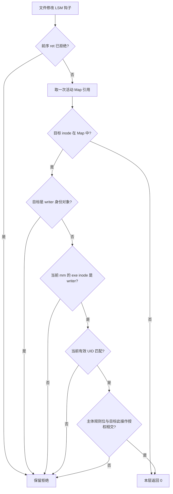

# 按执行对象授权文件修改

这是 BPF 文件只读策略的受限授权原型。配置为固定的程序 inode、有效 UID、目标 inode 与操作检查点授予修改例外。它提供可验证的对象匹配、在线撤销与程序对象保护；完整可信应用识别还需要内容认证、加载链与运行上下文约束。

```text
revision 1
protect "/srv/secmon-demo/data"
allow-writer "/opt/secmon-demo/writer" 65534 "/srv/secmon-demo/data" open-write,write
```

可修改 [配置示例](../examples/writer-policy.conf) 后使用。继续使用 `secmon --policy FILE --self-protect SOCKET` 启动，用 `--reload SOCKET` 更新。没有 `allow-writer` 时保留原来的全任务只读行为。最多 256 条 `protect` 和 64 条 `allow-writer`；同一执行 inode 只能配置一个有效 UID。每条规则只授予一个显式 protect 目标上的选定操作；同程序对不同目标可写多条规则，分别占用 64 条预算。原来只有程序/UID 的全局授权语法已删除，不自动补齐目标或 all。

程序与目标使用双引号绝对路径，目标必须与同份配置的某条 protect 路径文本一致；字段可换序声明。UID 是 0..4294967294 的十进制数。程序必须是 root 所有、组/其他用户不可写、至少有一个执行位的普通文件；末尾符号链接拒绝。不同程序路径若指向同一个 inode，可使用相同 UID 为不同目标/操作授予规则，冲突 UID 拒绝整个候选。相同程序路径/目标路径组合不允许重复，操作应合并在同一逗号列表中。该检查不要求 ELF：脚本路径可以被选择，但普通 shebang 执行后的实际执行对象是解释器，因此脚本 inode 本身不会使它获得授权。

## 操作字段与实际检查点

操作列表不带引号，以逗号连接，不允许空项、重复项或未知项。显式 all 表示指定目标上的全部八类文件检查点，不能与其他名字混写，也不表示所有保护目标。

| 名称 | 对应检查 |
| --- | --- |
| open-write | 新增可写打开 |
| write | 普通 file_permission 写权限检查，包含已打开 FD 的普通写入 |
| truncate | 路径/FD 截断检查 |
| unlink | 删除指向该 inode 的链接 |
| rename | 重命名源或覆盖目标；两边都受保护时两边都必须授权 |
| link | 新建指向该 inode 的硬链接 |
| setattr | 已覆盖的属性变更检查，例如 chmod/时间等 |
| mmap-write | 新增共享可写 mmap 或通过 mprotect 增加写权限 |

名称表示检查点，不保证一个系统调用只经过一项。普通新写入通常需要 open-write,write；仅 write 可让已有 FD 写入，但拒绝新可写打开。仅 mmap-write 可用于已有 FD 的共享映射，但新打开仍需独立权限。截断也可能经过属性修改检查，应按实际调用链明确选择组合。私有映射不会写回文件，仍按既有语义允许。授权不绕过 DAC、其他 LSM 或 fanotify。

## 从内核模块思路理解

宿主以 `O_PATH` 打开路径，使用 `fstat` 得到设备主次号和 inode，并保存 FD。路径只负责首次选择，FD 固定对象以避免 inode 回收复用；不读取程序内容，不获取 SHA-256。已有配置来源 SHA-256 仍只代表配置原始字节。

`src/writer_identity.h/.cpp` 负责固定和检查；`src/file_policy.cpp` 将两类对象合入同一个 HASH Map。value 当前为 352 字节（含保险箱会话槽），包含只读、writer、身份保护标志、writer EUID、主体规则位集合与按操作索引的目标授权集合，以及可选的启动时钟租期截止时间。与保险箱共用最多 336 个不同 inode，宿主按路径分别持有最多 336 个 FD；保护路径和 writer 路径重合时合并标志。

| value 字段/标志 | 含义 |
| --- | --- |
| flags bit 0，数值 1 | 显式 protect 对象 |
| flags bit 1，数值 2 | 可作为修改主体的执行对象 |
| flags bit 2，数值 4 | 身份对象强制只读，优先于主体例外 |
| writer_euid，uint32 | 只有 writer 位存在时才参与主体 UID 匹配 |
| writer_rules，uint64 | 当前执行 inode 对应的规则位；同 inode 多条规则按位合并 |
| allowed_writers[8]，uint64 数组 | 此目标每个文件操作检查点允许的规则位集合 |

普通保护 flags 通常是 1，授权程序是 6，同时作为 protect 和 writer 的对象是 7。没有授权的目标其 allowed_writers 全零；零 UID 字段本身不授予 root 权限。最多 64 条规则按候选内的位置编号 0..63，主体位与目标某操作的位集合相交才允许。主体与目标处于同一个 Map，因此重排规则后不会把旧编号误用于新对象。

例如规则 0 授权程序 A 对目标 X 的 open-write/write，规则 1 授权同程序 A 对目标 Y 的 unlink。A 的 writer_rules 为二进制 11；X 的 write 掩码为 01，Y 的 unlink 掩码为 10，其余未授权检查点为 0。程序身份匹配还不够，目标和当前操作必须有交集。别名最终按同一 inode 合并，不按字符串授予新对象。

`eBPF/writer_identity.bpf.c` 在敏感操作发生时，通过 CO-RE 读取当前 `task->mm->exe_file->f_inode`，查询同一份策略中的 writer，比较 `task->cred->euid.val`，最后检查该操作的目标规则位交集。这里的 UID 是内核全局 kuid 坐标，不能直接当作容器内显示的 UID。没有使用 `comm`、argv、PID 缓存或 `/proc/PID/exe` 路径字符串。

| 情况 | 结果 |
| --- | --- |
| 同一程序经已有硬链接或改名后的路径执行，EUID 匹配 | 只有被该规则选中的目标/操作允许通过本层检查 |
| 普通 fork 后仍执行同一程序 | 持续按当前对象和 EUID 检查 |
| exec 成另一个未授权程序 | 下次操作拒绝，不永久继承父进程授权 |
| 未授权程序 exec 成授权程序 | 下次操作可以匹配授权 |
| 程序相同，EUID 不同 | 拒绝；root 没有隐式例外 |
| 原路径指向新 inode，即使新文件字节完全相同 | 不自动继承授权；需管理员发布并应用新策略 |
| 修改、删除、重命名或新建硬链接指向授权程序 inode | 拒绝，包括授权程序自身发出的请求 |
| 其他 LSM、DAC 或挂载规则已拒绝 | 本策略的例外不能覆盖其拒绝 |



图中的返回 0 只表示本层不拒绝，后续 fanotify 等检查仍可拒绝。rename 两个目标共用同一个 Map 引用；授予普通目标例外不允许覆盖另一个 writer 程序对象。

授权程序 inode 自动受到现有文件保护钩子的只读限制，即使它没有出现在 `protect` 中。保护程序代码的检查优先于 writer 例外，因此 writer 不能经已覆盖入口修改自己的授权 inode。程序升级应通过管理策略撤销/重新选择对象；父目录不递归保护，不能把路径一直存在当作保证。

## 更新与撤销

候选包含目标和 writer 全部 inode，完整准备后一次替换外层 Map 引用。路径缺失、程序权限不合格、冲突 UID、Map 准备失败都会保留旧版本的保护、授权及固定 FD。重载成功后新进入检查的操作使用新策略，在途 BPF 检查可能继续用旧快照；这不是系统调用屏障。

移除该执行 inode 的最后一条规则后，它的自动身份保护一起解除；若同一 inode 还在 `protect` 中，则继续按普通只读对象保护。已有打开的写 FD 仍经过普通 `file_permission` 检查。授权期间已建立的共享可写映射无法靠撤销这条规则追回，已覆盖钩子以外的异步/文件系统专用写路径也未完整验证。

管理状态的 `writer_paths` 显示已提交的 allow-writer 规则中的程序路径条数（同程序不同目标分别计数）；`protected_paths` 只计算显式 `protect` 路径，不包含 writer 自动保护的对象。条数不是不同 inode 数；活动版本与配置摘要能核对配置来源，尚不能列出当前内核对象授权表。所有管理客户端必须读取本包当前完整响应，不提供历史前缀。

## 可信边界

把通用 shell、Python、动态链接器或可以执行任意输入的程序列为 writer，会使该程序承载的代码具有同样例外。动态库、插件、环境变量、代码注入、打开的句柄传递和运行时数据都没有被这项对象匹配认证。此阶段没有受信的子进程策略，只按每次操作时的实际 exe 与 EUID 重新判断。

程序启动前已有的共享可写映射、权限检查到首次 attach 之间的竞态、文件系统自身可信度、解释器链、内容签名和跨重启连续保护尚未解决。高权限管理员还可以改变进程执行文件标识或卸载 BPF；这不是对宿主 root/内核失陷的隔离边界。fanotify 不消费 writer 授权，即使 BPF 放行，独立 fanotify 层仍可拒绝。

## 验证与阅读

```bash
ctest --test-dir build --output-on-failure
sudo python3 tests/run_privileged.py --build-dir build --only writer-identity writer-scope writer-capacity writer-layers
```

`tests/writer_scenario.cpp` 是专用原生程序，避免将系统解释器加入授权。`tests/writer_identity.py` 在临时目录中验证对象/EUID、fork/exec、硬链接、同名替换、argv[0] 伪装、脚本解释器、程序只读、错误候选回滚、FD 回收和撤销。常驻进程使用已有 FD 验证普通写入、截断、共享 mmap/mprotect 与私有映射。所有授权在临时 BPF 宿主退出后解除，不安装持久策略。

`writer-scope` 验证目标隔离、八类检查点、已有 FD 与新打开的区别、mmap/mprotect、重命名双操作数、目标/执行对象别名、规则重排、撤销与错误候选回滚。

`writer-capacity` 验证 256+64 个不同 inode 的实际容量与完整回滚，及同一对象同时具备多种标志时的优先级。`writer-layers` 使用同一配置验证 BPF 与 fanotify 的独立允许/拒绝和退出顺序，明确 open 门不撤销已有写 FD。可选 `--writer-soak-duration 30` 会保持 root/65534 两个授权程序进程和一个未授权进程存活，持续轮换 UID/撤销，并校验每次成功后的新操作、错误候选、摘要与 FD 回收。

`tests/file_policy_map.py` 还只读检查本实例的外层引用和内层键值。同时核对当前 352 字节 value 的规则位与目标操作矩阵（包括第 63 位），外部检查 FD 故意固定旧 Map，证明完整切换后旧快照仍可读取；关闭检查 FD 后轮询确认旧 Map ID 消失。自保护会拒绝外部读取宿主 fdinfo，因此该专题采用启动前后外层 Map ID 差集并要求唯一；如果同时启动别的实例造成歧义，会失败而不任意选择同名 Map。这个测试不写全局或其他实例的 Map。

独立规则模型与同进程持续负载可通过 [测试矩阵](TESTING.md) 运行。
